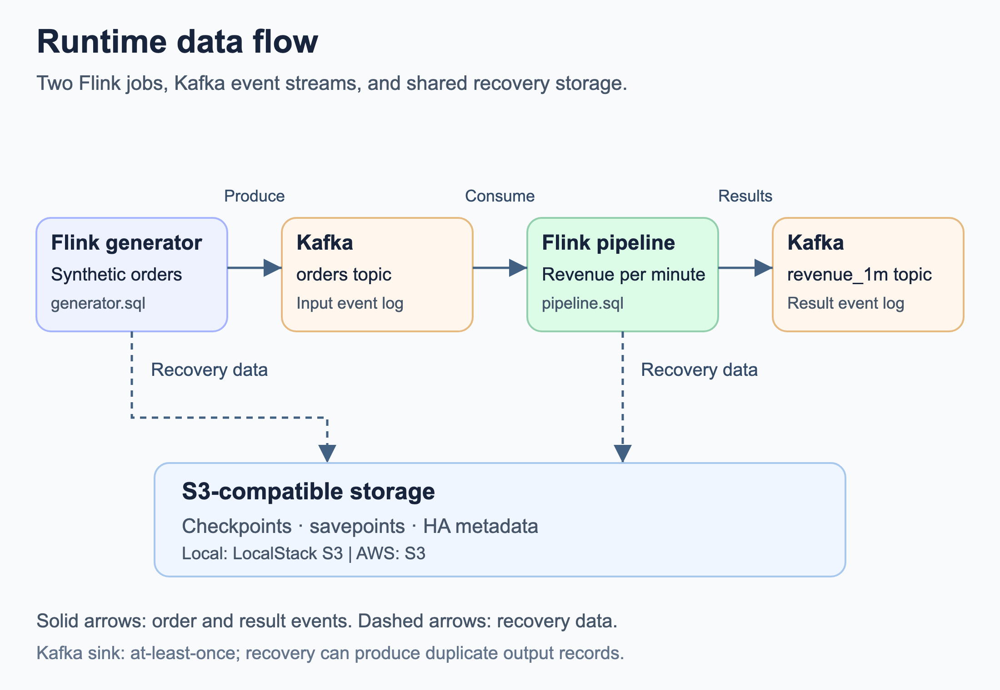
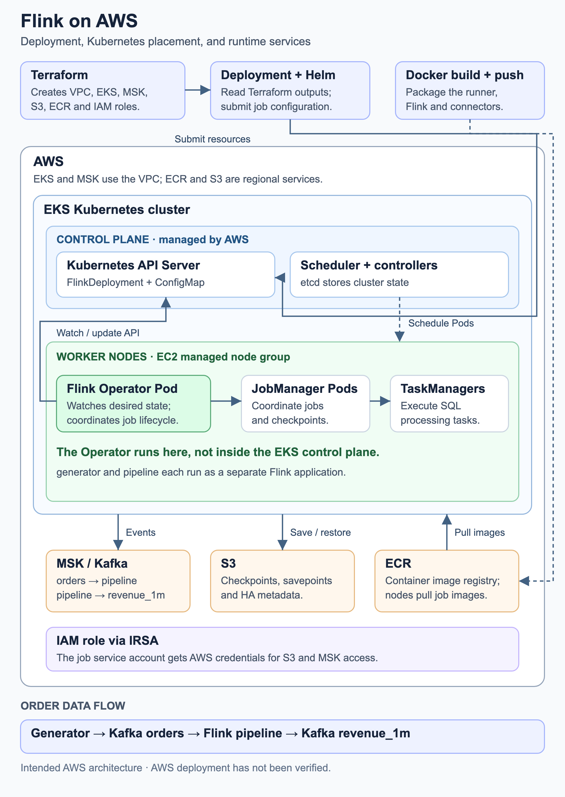

# flink-k8s-platform

One Flink SQL job, deployed two ways: a laptop, and AWS.

The point of the repo is the diff between those two. The query does not change,
the image does not change, and the Flink configuration changes by four lines.
Everything else that differs is infrastructure, kept where infrastructure
belongs.

## Architecture

### Runtime data flow

The chart is installed twice: `generator` simulates an upstream order service,
and `pipeline` aggregates orders by category in one-minute event-time windows.
Both are Flink jobs; a real order service can replace the generator.

<a href="docs/diagrams/runtime-data-flow.png">
  
</a>

[Vector diagram (SVG)](docs/diagrams/runtime-data-flow.svg) ·
[HTML source](docs/diagrams/runtime-data-flow.html)

Kafka retains the event streams; Flink performs the computation. Checkpoints
preserve computation state and source positions together for recovery. The
Kafka sink is currently at-least-once, so output records can be duplicated
after recovery.

### AWS deployment and control flow

This diagram shows the intended AWS deployment, which has **not been applied
or verified on AWS**. The diagram keeps the control plane, worker nodes, and AWS services in one
view. Click the image to open it at full resolution.

<a href="docs/diagrams/aws-architecture.png">
  
</a>

[Vector diagram (SVG)](docs/diagrams/aws-architecture.svg) ·
[HTML source](docs/diagrams/aws-architecture.html)


The **Flink Operator runs as a Pod on worker nodes**, alongside the workloads
it manages. Its role is control and management, but it is not part of the
AWS-managed EKS control plane. It watches the Kubernetes API and coordinates
Flink deployment and upgrades; JobManagers and TaskManagers run the jobs.

Terraform creates the infrastructure. Deployment commands explicitly pass its
outputs (bucket name, broker addresses, image repository and role ARN) to
Helm; there is no automatic Terraform-to-Helm synchronization. The job chart
creates `FlinkDeployment` resources and SQL ConfigMaps. SQL is mounted into
the job Pods as files, rather than baked into the image.

### Local equivalents

| Responsibility | Local development | AWS deployment |
|---|---|---|
| Kubernetes cluster | kind | EKS |
| Kafka | Strimzi-managed Kafka in the cluster | MSK in the VPC, outside EKS |
| Recovery storage | LocalStack S3 in the cluster | S3 |
| Job management | Flink Kubernetes Operator | Flink Kubernetes Operator |
| Job image | Built by Tilt and loaded into kind | Built and pushed to ECR |
| AWS authentication | LocalStack test credentials | IAM role via IRSA |
| Environment setup | kind and Tilt | Terraform, then deployment commands and Helm |

`terraform/envs/local` is a separate exercise for the S3 `checkpoints` module,
not the provisioner for the full local stack. Its default bucket is
`tf-checkpoints-local`; the Tilt-managed Flink stack uses `flink-checkpoints`.

## The diff that matters

`make diff-envs` renders the chart against both value files and diffs the
Flink configuration:

```diff
-    taskmanager.numberOfTaskSlots: "2"
+    taskmanager.numberOfTaskSlots: "4"
     state.backend.type: "rocksdb"
     state.backend.incremental: "true"
-    execution.checkpointing.interval: "30s"
+    execution.checkpointing.interval: "60s"
-    execution.checkpointing.dir: s3://flink-checkpoints/jobs/demo/checkpoints
+    execution.checkpointing.dir: s3://acme-flink-ckpt/jobs/demo/checkpoints
     execution.checkpointing.aligned-checkpoint-timeout: "30s"
     high-availability.type: kubernetes
-    s3.endpoint: "http://localstack...:4566"
-    s3.path.style.access: "true"
-    s3.access-key: "test"
-    s3.secret-key: "test"
     pipeline.max-parallelism: "720"
```

Two tuning numbers, a bucket name, and four lines that **disappear** in
production because IRSA replaces them. There are no static AWS credentials
anywhere in the production path. The SQL differs in the same way: with
`kafka.iamAuth` on, each Kafka table gains four `SASL_SSL` / `AWS_MSK_IAM`
options and nothing else changes.

## Layout

| Path | What it is |
|---|---|
| `app/` | A SQL runner, a topic-creation tool, and the Dockerfile. The jar never changes. |
| `charts/flink-job/` | One Helm chart, installed twice. The SQL lives here, not in the image. |
| `local/` | kind cluster, Tiltfile, Strimzi and LocalStack manifests. |
| `terraform/modules/` | vpc, eks, ecr, checkpoints, flink-irsa, msk. |
| `terraform/envs/prod/` | Wires them together. |
| `terraform/envs/local/` | The checkpoints module, applied against LocalStack. |
| `docs/prod-deploy.md` | The path from `terraform apply` to running jobs. |

The job's SQL is a mounted ConfigMap, so changing the pipeline is a config
change and a restart, not a rebuild and a push. A file is always exactly one
job: `SET` lines go into the config, and every `INSERT` is submitted in one
statement set.

## Running it locally

Needs Docker with about 8 GB, plus `kind`, `tilt`, `helm` and `kubectl`.

```sh
make local-up        # kind cluster, then `tilt up` (interactive)
make local-ci        # or: bring it up, wait until ready, exit
make local-status    # job state, pods, and the checkpoint bucket
```

Tilt brings the layers up in order: cert-manager, Strimzi, Kafka and its
topics, LocalStack and the checkpoint bucket, the Flink operator, then the two
jobs. Under `tilt up` the Flink UIs are at <http://localhost:8081> (pipeline)
and <http://localhost:8082> (generator).

The default is one Kafka broker, which fits in 8 GB (the whole stack sits
around 6 GB). `KAFKA_BROKERS=3 make local-up` gives a replicated cluster and
wants about 12 GB.

```sh
make test            # unit tests for the SQL runner
make lint            # helm lint, both value sets
make diff-envs       # the diff above
make kind-down
```

## What is actually verified

Being precise about this, because "it deploys to AWS" is easy to claim:

| | Status |
|---|---|
| SQL runner: splitting, `SET`, statement sets | ✅ 9 unit tests |
| Local stack end to end on kind | ✅ both jobs `RUNNING`/`STABLE`, windows arriving in `revenue_1m` |
| Checkpoints, savepoints and HA metadata written to `s3://` | ✅ against LocalStack |
| Operator-driven upgrade: savepoint, stop, restore on a new image | ✅ observed locally |
| Topic tool: create, already-exists, partition mismatch | ✅ against the local Kafka |
| `checkpoints` Terraform module applied and destroyed | ✅ against LocalStack, all 5 resources |
| Terraform syntax, types, module wiring | ✅ `validate` on all 8 directories, `fmt` clean |
| Helm chart renders for prod, including IAM auth | ✅ `lint` and `template` only |
| MSK IAM auth actually authenticating | ❌ needs MSK |
| IRSA actually reaching S3 from a pod | ❌ needs EKS |
| `terraform plan` or `apply` against AWS | ❌ **never run** |

Running it for real found things that linting and validating could not: the
operator chart and this repo both wanting to own the `flink` service account,
pinned chart versions whose URL or API had since gone away, `SET` being
rejected by `executeSql()`, and an S3 lifecycle rule that would have deleted
state a running job still referenced. Assume the AWS half has its own share of
those waiting. `docs/prod-deploy.md` lists where to look first.

## Why LocalStack, and only for S3

Locally the checkpoint store just has to speak S3. Any S3-compatible server
would do and the Flink configuration would be identical; LocalStack is used
because MinIO's community images are no longer published, and because the same
emulator can also take a real `terraform apply` of the checkpoints module.

It is pinned to 3.8, the last version that starts without an account token.
That pin has a cost: `terraform/envs/local` has to pin an older AWS provider to
match it.

It is not used for EKS, MSK or VPC. Those are mocked API responses:
`terraform apply` goes green without proving the network would come up on real
AWS. A green run that proves nothing is worse than no run, so those stop at
`validate`, and kind and Strimzi cover the local case instead.

## Notes

The pipeline is the same query as a UCSC Extension course lab, deliberately:
the interesting part here is not the SQL.

Versions are pinned (Flink 1.20.0, Flink operator 1.16.1, Strimzi 1.3.1 with
Kafka 4.3.2, cert-manager 1.21.3, EKS module ~> 20.31). Two of the original
pins had already rotted by the time this was first run; check them again.

Not here yet: metrics and alerting, periodic savepoints, CI, and exactly-once
delivery on the Kafka sink (it is at-least-once).
